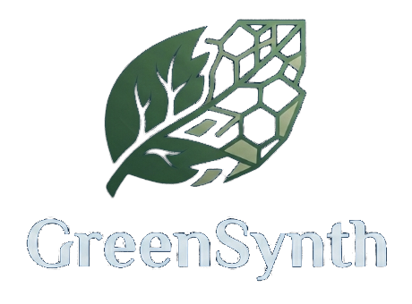

<p align="center">
  
</p>

<h1 align="center">GreenSynth Analytics Platform</h1>

<p align="center">
  <strong>A Data-Driven Research and Analytics Platform for Green Synthesis of Semiconductor Materials</strong>
</p>

<p align="center">
  <a href="https://hub.xerj.org/contributors/V-atharvan"></a>
  <a href="https://github.com/V-atharvan/GreenSynth/actions/workflows/ci.yml"></a>
  <a href="https://doi.org/10.5281/zenodo.23643273"></a>
  <a href="https://opensource.org/licenses/MIT"></a>
  
</p>

---

## Overview

**GreenSynth Analytics** is an open-source, full-stack scientific research software and materials informatics platform engineered specifically for the green synthesis of semiconductor materials (nanoparticles and nanostructured thin films).

The platform bridges wet-laboratory synthesis protocols with automated, reproducible scientific computing: ingesting raw instrumental outputs (XRD, UV-Vis, FTIR, SEM, and electrical I-V probe stations), executing deterministic physical property derivations, preserving cryptographic data provenance, and generating publication-ready PDF research dossiers.

### Core Scientific Principles
1. **End-to-End Traceability:** Every calculated physical property is immutably linked to the raw instrument file hash, processing parameters, mathematical formula, and algorithm version.
2. **Strict Data Category Isolation:** Data entities are explicitly partitioned and tagged as `MEASURED`, `CALCULATED`, `STATISTICAL`, `PREDICTED`, or `VALIDATED`.
3. **Cryptographic Immutability:** Raw experimental instrument files receive a SHA-256 checksum upon upload and are write-protected.
4. **Configuration-Driven Multi-Project Architecture:** Supports 8 laboratory configurations (P1 through P8) spanning sol-gel, hydrothermal, and spray pyrolysis routes without hardcoded business logic.
5. **Scientific Rigor & Honesty:** Calculations enforce physical validation boundaries (e.g., blocking electrical conductivity derivation when sample geometry is missing, or logging notices when Tauc plots use uncalibrated absorbance proxies).

---

## Scientific Analytical Engines

GreenSynth packages domain-specific characterization algorithms into deterministic Python calculation engines:

- **X-Ray Diffraction (XRD) Crystallite Sizing:**  
  Automates Savitzky-Golay smoothing, peak detection, and full width at half maximum (FWHM) extraction for monoclinic tenorite $\text{CuO}$ reflections. Computes crystallite domain size ($D$) via the Debye-Scherrer equation with instrumental broadening subtraction:
  $$D = \frac{K \lambda}{\beta \cos\theta}, \quad \beta = \sqrt{\beta_{\text{obs}}^2 - \beta_{\text{inst}}^2}$$
- **UV-Vis Optical Band Gap Extrapolation:**  
  Converts wavelength to photon energy ($h\nu = 1239.8419/\lambda\text{ eV}$), computes absorption coefficients ($\alpha = 2.303 A / t$), evaluates direct/indirect Tauc transformations ($(\alpha h\nu)^{1/n}$ vs. $h\nu$), and performs linear tangent regression on the absorption edge to derive the optical band gap ($E_g = -\mathrm{intercept}/\mathrm{slope}$).
- **FTIR Spectroscopy & Functional Group Attribution:**  
  Applies polynomial baseline correction and noise filtering to identify characteristic vibrational modes (e.g., $\text{Cu--O}$ lattice vibrations at $530\text{--}610\text{ cm}^{-1}$ and phytochemical capping bands from polyphenols and flavonoids).
- **Electrical Transport & I-V Transport Analysis:**  
  Processes current-voltage ($I\text{--}V$) sweeps, verifies Ohmic linearity via linear regression slope ($R = \mathrm{d}V/\mathrm{d}I$), and calculates thin-film electrical resistivity ($\rho = R \cdot A / L$) and conductivity ($\sigma = 1/\rho$) when physical geometry is specified.
- **Scanning Electron Microscopy (SEM) Calibration:**  
  Provides digital scale-bar calibration and interactive distance measurement tools for thin-film surface morphology.
- **Design of Experiments (DOE) & Optimization:**  
  Generates seed-reproducible Factorial, Fractional Factorial, Box-Behnken, and Central Composite Design (CCD) matrices to guide experimental exploration.
- **Materials Informatics & Machine Learning Pipeline:**  
  Features an automated dataset builder with strict target leakage protection, 5 regressors (Baseline, Linear, Ridge, Random Forest, Gradient Boosting), 5-fold cross-validation, residual uncertainty estimation, and applicability domain checks.
- **Automated PDF Research Dossier Compiler:**  
  Compiles complete 14-section research dossiers with high-resolution vector charts, synthesis recipes, derived properties, and cryptographic audit logs via ReportLab.

---

## Technology Stack

- **Frontend:** React 18, TypeScript, Vite, Tailwind CSS, Lucide Icons, Vitest
- **Backend:** Python 3.11+, FastAPI, Pydantic v2, SQLAlchemy 2.0 (Async), Alembic, ReportLab
- **Scientific Computing:** NumPy, SciPy, Pandas, Scikit-learn, Matplotlib
- **Database:** PostgreSQL 16 / SQLite (in-memory test mode)
- **Code Quality & CI:** Ruff, Black, Mypy, ESLint, GitHub Actions
- **Containerization:** Docker, Docker Compose

---

## Repository Structure

```
CRTD/
├── backend/                  # FastAPI Application
│   ├── app/
│   │   ├── api/             # REST Route handlers (/projects, /experiments, /samples, /characterizations, etc.)
│   │   ├── core/            # Configuration (pydantic-settings), security, logging, rate limiting
│   │   ├── database/        # Async SQLAlchemy session, Base, and multi-project catalog seeds
│   │   ├── models/          # ORM models (Projects, Experiments, Samples, Characterizations, AnalysisRuns, ML)
│   │   ├── schemas/         # Pydantic v2 schemas (validation, parameters, and responses)
│   │   ├── services/        # Service layer (business logic orchestration, file handling, DOE)
│   │   ├── scientific/      # Scientific calculation engines (XRD, UV-Vis, FTIR, Electrical, SEM)
│   │   ├── analytics/       # Statistical analytics (descriptive, correlation, OLS regression, ANOVA)
│   │   ├── ml/              # Machine learning dataset builder, regressors, CV, domain bounds
│   │   ├── optimization/    # Experimental optimization & candidate generation engines
│   │   ├── reporting/       # Scientific ReportLab PDF dossier generation engine
│   │   ├── evidence/        # Evidence scoring, evaluation, and model health tracking
│   │   ├── validation/      # Closed-loop prediction error validation & drift detection
│   │   └── storage/         # Cryptographic SHA-256 file preservation & storage abstraction
│   ├── alembic/             # Database migration versions
│   ├── tests/               # Pytest suite (118 unit & integration tests)
│   └── pyproject.toml
│
├── frontend/                 # React + TypeScript + Vite Application
│   ├── src/
│   │   ├── components/      # UI components (SpectraPlot, TaucPlot, StatusBadge, DataClassifier, etc.)
│   │   ├── pages/           # Pages (Dashboard, Projects, Experiments, Characterizations, ML Center, Reports)
│   │   ├── layouts/         # Collapsible sidebar and responsive research layout
│   │   ├── services/        # Typed API clients (Axios)
│   │   ├── types/           # TypeScript interfaces mirroring backend schemas
│   │   └── index.css        # Clean, accessible laboratory design system
│   └── package.json
│
├── data/                     # Persistent Data Storage
│   ├── raw/                 # Original laboratory data files (immutable, SHA-256 hashed)
│   └── processed/           # Processed datasets and transformed spectra
│
├── sample_data/              # Authentic laboratory benchmark CSV datasets for Project P7
├── synthetic_data/p7/        # Physics-constrained 400-run simulation suite for ML benchmarking
├── docs/                     # Comprehensive architecture, scientific specs, and user manuals
│   └── branding/            # Official GreenSynth logo and visual assets
├── Start GreenSynth.bat      # One-click Windows development launcher
├── GreenSynth Status.bat     # Service health inspection utility
├── Stop GreenSynth.bat       # Safe process termination script
├── docker-compose.yml        # Multi-container Docker configuration
├── .env.example              # Environment variables template
└── README.md
```

---

## Quick Start (One-Click Windows Launcher)

For Windows local development, start the entire platform with one click:

### Start GreenSynth
Double-click:
```
Start GreenSynth.bat
```
*(Or run `.\Start GreenSynth.bat` from CMD / PowerShell).*

**What happens automatically:**
1. Validates repository structure and paths (supports spaces and any project directory).
2. Verifies Python (3.11+) and Node.js (18+) / npm dependencies.
3. Prepares `.env` and installs `frontend/node_modules` if missing.
4. Starts FastAPI backend on `http://localhost:8000` with hot-reload in a dedicated terminal.
5. Starts Vite frontend dev server on `http://localhost:5173` with hot-reload in a dedicated terminal.
6. Automatically opens `http://localhost:5173` in your default web browser.

### Check Service Status
Double-click:
```
GreenSynth Status.bat
```
Displays live status and health metrics for Backend, Frontend, and Database.

### Stop GreenSynth
Double-click:
```
Stop GreenSynth.bat
```
Safely terminates only the GreenSynth backend and frontend processes.

---

## Quick Start (Docker Compose)

To start the entire containerized stack with Docker Compose:

```bash
# 1. Clone repository
git clone https://github.com/V-atharvan/GreenSynth.git
cd GreenSynth

# 2. Configure environment
cp .env.example .env

# 3. Start services
docker compose up --build
```

### Services & Ports:
- **Frontend UI:** `http://localhost:5173`
- **Backend API:** `http://localhost:8000`
- **FastAPI Interactive Docs:** `http://localhost:8000/docs`
- **PostgreSQL Database:** `localhost:5432`

---

## Local Development (Manual Setup)

### Backend Setup:
```bash
cd backend
python -m venv .venv

# On Windows:
.venv\Scripts\activate
# On Linux/macOS:
source .venv/bin/activate

pip install -e ".[dev]"

# Run database migrations
alembic upgrade head

# Start FastAPI server
uvicorn app.main:app --reload --port 8000
```

### Frontend Setup:
```bash
cd frontend
npm install
npm run dev
```

---

## Testing & Quality Assurance

GreenSynth maintains a comprehensive, automated test suite covering unit logic, integration pipelines, mathematical accuracy, and cryptographic file security:

```bash
# Backend Tests (Pytest - 118 unit and integration tests):
cd backend
pytest

# Frontend Component Tests (Vitest):
cd frontend
npm run test
```

Scientific derivation accuracy is benchmarked against **OriginLab 2024** and manual derivations:
- Crystallite size ($D$): relative error $< 0.35\%$
- Optical band gap ($E_g$): relative error $< 0.60\%$
- Electrical resistance ($R$): relative error $< 0.01\%$

---

## Platform Status & Data Integrity

- **Multi-Project Seed Data:** Configured with catalog metadata for 8 green synthesis projects (P1 through P8). Project 7 (phytochemical spray pyrolysis of $\text{CuO}$ thin films using mulberry extract in ethanol) is configured as the primary MVP case study.
- **Zero Fabricated Results:** The platform database contains strictly verified parameter definitions and genuine laboratory files. Demonstrations of machine learning pipelines on synthetic benchmark suites (`synthetic_data/p7/`) are explicitly labeled with `SIMULATED_BENCHMARK` provenance tags to protect scientific integrity.

---

## Community & Contributing

We welcome contributions, bug reports, and scientific enhancements! Please review:
- [Contributing Guidelines](CONTRIBUTING.md) for development setup, testing, and PR conventions.
- [Code of Conduct](CODE_OF_CONDUCT.md) for community standards.
- [Citation Guide](CITATION.cff) for attributing GreenSynth in academic research.

---

## License

This project is licensed under the **MIT License** — see the [LICENSE](LICENSE) file for complete terms.
